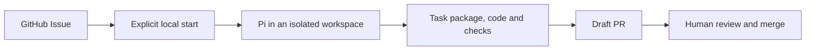

<p align="center">
  
</p>

# Daqin

**Your agents. Your workflow. Built on Git.**

Daqin is a Git-native development project for one coding agent or a team.
It is being built to connect approved tasks, isolated branches and code review
through GitHub and GitLab. You choose the participants and workflow.

Daqin means “Great Qin,” inspired by the Qin dynasty's unification and shared
standards. The goal is to let different agents work together with shared task and
delivery rules while preserving each tool's native capabilities.

> **Status: project bootstrap.** There is no runnable controller or released
> agent integration yet. The behavior below describes the intended product.

## Work your way

The initial target is a human and one Pi agent working through GitHub:

1. The human gives a task and confirms its scope.
2. The selected agent works in an isolated branch and records its delivery.
3. The human checks the result and performs the final merge.

Planning agents, parallel contributors, automated review and full team workflows
are optional. Roles are user-defined: Planner, Worker and Reviewer are examples,
not required participant types. A single-agent run does not need a team template.

Issues, comments, pull requests, merge requests and CI can carry collaboration
and evidence. Configured checks and platform protections still apply. When
independent agent review is enabled, it must use independent context and identify
the reviewed version; a human can also review directly.

## First useful release

Start with one GitHub Issue, one noninteractive Pi agent and one isolated task
branch. You start the run locally. GitHub holds the task, feedback and a draft pull
request (Draft PR) with the actual check results. After leaving feedback, you
explicitly continue the task to update the same PR. The human performs the merge.



The [Roadmap](ROADMAP.md) moves through a real integration experiment,
repeatable delivery, basic failure handling and a useful real-project task.
All are planned; none has passed runtime acceptance yet.

## Design boundaries

- Save the accepted requirements and delivery notes in a task package.
  Commit it on the task branch and keep it after merging. Keep raw sessions and credentials out of the delivery.
- Use one active writer per task. Record failures, stop managed execution,
  and check the workspace, process and platform before retrying after an
  interruption or an uncertain publish result.
  A process exit or an agent's claim is not acceptance evidence.
- Use explicit operations to start, stop and continue. Natural-language
  discussion does not trigger work. Platform comment commands come later.
- Use the operator's existing platform account for the prototype and label
  automated posts. Account sharing does not enforce human/agent separation.
- Use trusted local execution and the existing development environment.
  Worktree isolation is not a security sandbox.
- Use TypeScript, Node.js and SQLite, initially on Linux. Begin with serial
  tasks and keep deployment paths configurable. There are no universal team
  sizes, task time limits or repair-round caps.
- Add GitLab once the GitHub workflow is familiar and useful. Codex
  collaboration, parallel work, native TUI and optional Herdr follow actual
  needs. Claude Code, Kimi Code and standalone local Git are later candidates.
  Preserve user-defined roles and optional workflows as capabilities grow.
- Leave final merging to a human. Automatic merging, production deployment
  and distributed scheduling are outside the initial scope.

## Development setup

The selected product stack is TypeScript, Node.js and SQLite. Runtime
implementation, package layout and adapter interfaces are still to be built.
This bootstrap only needs Git and Python 3.10+ for repository checks; Python
is used for those checks, not for the planned controller.

```sh
git clone git@github.com:M1racleShih/daqin.git
cd daqin
python3 scripts/check_repository.py
```

With dskills installed (bootstrap verified with version 0.1.0):

```sh
dskills sync --project .
dskills --json status --project .
dskills doctor --project .
```

Only the `dynamic-skills` manager is selected initially. The selected skills and their exact
versions are tracked; generated skill copies and local state are ignored. Read
specialist skills on demand and add a project pin only for recurring needs.
See [CONTRIBUTING.md](CONTRIBUTING.md) for the collaboration workflow and
[AGENTS.md](AGENTS.md) for agent instructions.

## License and identity

Original project materials are provided under the [MIT License](LICENSE).
Third-party integrations must retain their own notices and license terms.
The logo and its creation brief are in [assets](assets/README.md).
