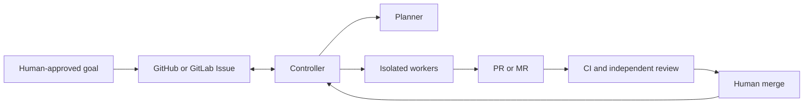

<p align="center">
  
</p>

# Qinxi

**One mission. Many agents. Every handoff accounted for.**

Qinxi is a Git-native coordination project for coding agents. It is designed
to turn approved goals into isolated tasks, reviewed pull requests or merge
requests, and a traceable path to a human merge on GitHub and GitLab.

The name means “Qin seal,” drawing on the Qin dynasty's tradition of unified
standards and seals as a sign of authority. Different tools share one task
and delivery contract while keeping their native capabilities.

> **Status: project bootstrap.** There is no runnable controller or released
> agent integration yet. The behavior below describes the intended product.

## Intended workflow

1. A human confirms the goal, scope, acceptance criteria and execution budget.
2. A planner proposes tasks and dependencies within that authorization.
3. Workers use separate worktrees or clones and one branch per active task.
4. CI and an independent reviewer evaluate a specific delivery version.
5. The human performs the final merge; the controller reconciles the result.

Issues and comments are the primary control surface. Pull requests, merge
requests and CI carry delivery evidence. Board columns and labels show
progress; persistent controller records determine who owns a running task.



## Design boundaries

- Start with Pi, then validate other tools through capability-based adapters.
  Codex, Claude Code and Kimi Code are candidates, not implemented support.
- Support both noninteractive CLI/SDK/RPC execution and native TUI sessions.
  Herdr is an optional terminal host and team visualization surface.
- Opening a view attaches to an existing run. Human input requires exclusive
  control handoff; switching between execution modes depends on the adapter.
- Give each task an immutable specification snapshot and each attempt one
  active writer. Reject stale attempts and stale review results.
- Keep scheduling, retries, budgets and recovery in a deterministic controller.
  Use agents for planning, implementation and review judgments.
- Begin with one controller and one target repository per run. Automatic
  merging, production deployment and distributed scheduling are outside the
  initial scope.

## Development setup

This bootstrap needs Git and Python 3.10+ for repository checks. The product
runtime, package layout and adapter interfaces will be selected during the
first implementation milestone; Python is only used for the current checks.

```sh
git clone git@github.com:M1racleShih/qinxi.git
cd qinxi
python3 scripts/check_repository.py
```

With dskills installed (bootstrap verified with version 0.1.0):

```sh
dskills sync --project .
dskills --json status --project .
dskills doctor --project .
```

Only the `dynamic-skills` manager is selected initially. Selection and exact
pins are tracked; generated skill copies and local state are ignored. Read
specialist skills on demand and add a project pin only for recurring needs.
See [CONTRIBUTING.md](CONTRIBUTING.md) for the collaboration workflow and
[AGENTS.md](AGENTS.md) for agent instructions.

## License and identity

Original project materials are provided under the [MIT License](LICENSE).
Third-party integrations must retain their own notices and license terms.
The logo and its creation brief are in [assets](assets/README.md).
