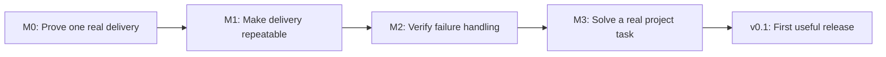
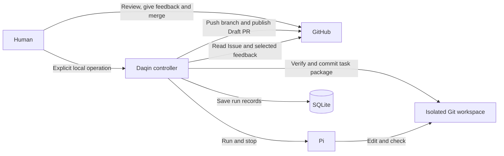

# Roadmap

Daqin is at the bootstrap stage. No runtime milestone has passed yet.
The first useful release targets **GitHub and one noninteractive Pi agent** on
Linux. Milestones describe observable outcomes, not calendar commitments.

## First useful release: v0.1

| Milestone | Deliverable | Acceptance evidence |
| --- | --- | --- |
| M0 | A small real change from a GitHub Issue, made by Pi in an isolated workspace | Actual checks, source commit and Draft PR in a dedicated test repository |
| M1 | Local start, status, stop and continue operations; task snapshots and delivery records | Distinct Issues deliver independently; human feedback updates the same branch and PR |
| M2 | Visible failures, one owner per task, cancellation and checks after interruptions | Repeated starts do not duplicate execution; interruptions and uncertain publication do not duplicate PRs |
| M3 | A useful change in a real GitHub project | A task package, actual checks, an accepted delivery and a human-performed merge |

All four milestones are required for v0.1. Basic failure visibility, stopping
and duplicate protection begin in M1; M2 verifies and strengthens them.
Validate the target GitHub API and Pi execution behavior before building a
general framework. Estimate further work after M0 provides integration evidence.

## Initial architecture and flow

One approved Issue leads to one task branch and Draft PR. A task package records
the accepted requirements and delivery notes. It stays on the branch and is
kept after merging. Real check results and unverified items accompany the delivery.

Humans read and discuss work in GitHub, then explicitly start or continue it
locally. A run may stop after an interruption and require explicit continuation
after checking the saved state against the workspace and platform. Initial serial execution is an implementation scope,
not a universal team-size or task-duration limit. Existing checks and branch
protections still apply. Final merge belongs to the human.

## Expand when there is a demonstrated need

| Capability | Smallest useful validation |
| --- | --- |
| GitHub comment commands and a persistent runner | Authorized explicit commands work; discussion, duplicates and controller replies do not trigger execution |
| GitLab, after the GitHub workflow is familiar and useful | Repeat the single-agent delivery path with a real merge request |
| Pi and Codex collaboration | Complete a meaningful handoff with user-defined responsibilities |
| Parallel tasks | Independent work proceeds together; dependencies, shared resources and integration changes are handled |
| Native TUI and optional Herdr | Observe the existing run, allow one input owner and check for changes before continuing |
| Standalone local Git, Claude Code and Kimi Code | Define a concrete use case and verify its task-to-delivery path |

These are future directions, not a promise to ship them together. Workflows and
roles remain optional. Do not build unused adapters or a workflow framework
before the first path is useful. Automatic merging, production deployment and
distributed scheduling are outside the current roadmap.
